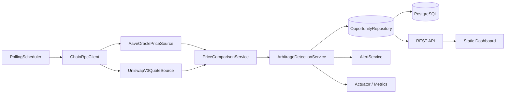

# DeFi Oracle Arbitrage Monitor — Learning Roadmap

## 1. What this project is (and is not)

The monitor compares two prices for the same asset pair:

- **Oracle price** — Aave V3 `AaveOracle.getAssetPrice(asset)`, a Chainlink-backed USD price with 8 decimals.
- **DEX price** — an executable Uniswap V3 `QuoterV2` quote for WETH → USDC at a chosen fee tier and notional.

It computes the divergence in basis points (bps), stores it, exposes it through an API, and can alert when the divergence crosses a threshold.

A divergence is **not** by itself a risk-free arbitrage. Aave is a lending market, not a spot exchange, so you cannot simply "buy on Aave and sell on Uniswap." The monitor is a **signal and research tool**. A later phase can attach a concrete strategy (liquidation health factors, oracle-lag simulation, cross-venue execution) and only then estimate P&L. Keeping that distinction explicit makes the project honest and much more useful as a learning exercise.

## 2. Scope and assumptions

- Read-only: no wallets, private keys, or transaction signing.
- Ethereum mainnet (chain id 1) first; L2 support later through configuration.
- One pair first: WETH/USDC, 0.05% fee tier. Multi-pair and multi-tier later.
- Java 25, Spring Boot 4.1.2, Gradle, PostgreSQL.
- Local development against an Anvil mainnet fork or a public/paid RPC.
- Static HTML/CSS/JS dashboard for the MVP (no Node build step).
- Tests use recorded JSON-RPC fixtures; fork tests are opt-in.

**Non-goals for the MVP:** trade execution, MEV bundles, private mempool, a full backtesting engine, multi-chain, authentication, multi-user support.

## 3. Target architecture



Main components:

| Component | Responsibility |
|---|---|
| `ChainRpcClient` | JSON-RPC transport, timeouts, retries, error mapping |
| `AbiCodec` | Encode/decode the two contract calls |
| `AaveOraclePriceSource` | Read and scale the oracle price |
| `UniswapV3QuoteSource` | Quote a swap and derive the DEX price |
| `PriceComparisonService` | Decimal-safe normalization and edge calculation |
| `ArbitrageDetectionService` | Threshold, hysteresis, cooldown, episode lifecycle |
| `PollingScheduler` | Block-aware polling; skip duplicate blocks |
| `OpportunityRepository` | JPA persistence and queries |
| `AlertService` | Logging first, Telegram later |
| REST API + dashboard | Read-only visibility |

## 4. Milestones

### M0 — Walking skeleton (0.5–1 day)

Tasks:

- Add `compose.yaml` with PostgreSQL 17 (and optionally Anvil).
- Add Flyway, datasource configuration, Actuator, validation.
- Add `GET /api/v1/chain/block-number` backed by JSON-RPC.
- Add `.env.example`, a local Spring profile, and README run instructions.
- Add a root `.gitignore` for `.idea/`, `.DS_Store`, build output, and `.env`.

Acceptance:

- `docker compose up -d` and `./gradlew bootRun` start the app.
- The block-number endpoint returns a number from the local fork or RPC.
- `./gradlew test` passes without external services.

Concepts: Spring Boot auto-configuration, `@ConfigurationProperties`, `RestClient`, JSON-RPC, Docker Compose, Flyway.

### M1 — Read both prices at one block (1–2 days)

Tasks:

- Implement `eth_blockNumber` and `eth_call` with an explicit block tag.
- Aave: encode `getAssetPrice(address)`, decode `uint256`, scale by `1e8`.
- Uniswap: encode `quoteExactInputSingle(...)`, decode the four return words, derive the price.
- Pin both calls to the same block number; skip polling if the block has not changed.
- Unit tests with captured JSON-RPC fixtures; optional Anvil integration test.

Acceptance:

- A status endpoint or structured log shows block, oracle USD, DEX USD, raw amounts, and edge bps.
- Tests cover hex encoding/decoding, decimal scaling, and revert/error responses.

Concepts: ABI encoding, function selectors, token decimals, `BigInteger`/`BigDecimal`, `eth_call` semantics, QuoterV2.

### M2 — Detect and persist divergences (1 day)

Tasks:

- `PriceComparisonService`: edge bps with an explicit `MathContext`; direction enum.
- `ArbitrageDetectionService`: threshold, hysteresis, cooldown, episode aggregation.
- Flyway migration for `price_snapshot` and `opportunity`.
- Scheduled poller; structured logs; no overlapping polls.
- Repository queries: recent, top edge, time range.

Acceptance:

- A forced divergence fixture opens exactly one episode; repeated polls update `last_seen_at` and `max_edge_bps`.
- Persisted values round-trip exactly (`NUMERIC`, never `double`).

Concepts: JPA, transactions, idempotency, scheduling, state machines.

### M3 — API + dashboard (1 day)

Tasks:

- REST DTOs, validation, and a `ProblemDetail` exception handler.
- `GET /api/v1/status`, `/api/v1/opportunities`, `/api/v1/opportunities/{id}` with pagination.
- OpenAPI via springdoc.
- Static dashboard: price cards, edge chart, opportunities table; poll every 5 seconds.
- Optional SSE stream.

Acceptance:

- The dashboard shows live prices and history.
- The API is documented at `/swagger-ui.html`.

Concepts: REST design, DTO mapping, OpenAPI, `fetch`, Chart.js.

### M4 — Make it robust (1–2 days)

Tasks:

- Timeouts, retries with backoff, optional circuit breaker.
- Health indicators for RPC and database; metrics for poll latency, errors, and current edge.
- Alert abstraction: log plus optional Telegram; cooldown and severity.
- Config validation; fail fast on bad addresses or decimals.
- Graceful shutdown; retention job for old snapshots.

Acceptance:

- Killing the RPC does not crash the app; health goes `DOWN` and recovers.
- Metrics are visible at `/actuator/prometheus`.

Concepts: resilience, observability, operations.

### M5 — Stretch goals (pick your own)

- Multi-pair and multi-fee-tier best quote.
- Gas-aware net edge: `net = gross - gasUsd - fees - slippageBuffer`.
- Oracle staleness: `latestRoundData().updatedAt`, heartbeat/deviation thresholds.
- Cross-venue (Uniswap vs Sushi/Curve) and triangular arbitrage.
- Aave liquidation monitor: health factors, close factor, liquidation bonus. This is a more realistic "oracle arbitrage" strategy.
- Historical replay/backtest with archive RPC; store block-pinned quotes.
- WebSocket `newHeads` instead of polling; reorg-aware confirmations.
- Docker image, GitHub Actions CI, deployment.

## 5. Data model (MVP)

```sql
CREATE TABLE price_snapshot (
    id             BIGSERIAL PRIMARY KEY,
    block_number   BIGINT        NOT NULL,
    block_hash     TEXT,
    observed_at    TIMESTAMPTZ   NOT NULL,
    pair           TEXT          NOT NULL,
    oracle_price   NUMERIC(38,18) NOT NULL,
    dex_price      NUMERIC(38,18) NOT NULL,
    edge_bps       NUMERIC(20,4) NOT NULL,
    amount_in      NUMERIC(38,0) NOT NULL,
    amount_out     NUMERIC(38,0) NOT NULL,
    fee_tier       INTEGER       NOT NULL,
    UNIQUE (block_number, pair, fee_tier)
);

CREATE TABLE opportunity (
    id                 BIGSERIAL PRIMARY KEY,
    pair               TEXT          NOT NULL,
    direction          TEXT          NOT NULL,
    started_at         TIMESTAMPTZ   NOT NULL,
    last_seen_at       TIMESTAMPTZ   NOT NULL,
    ended_at           TIMESTAMPTZ,
    start_block        BIGINT        NOT NULL,
    last_block         BIGINT        NOT NULL,
    max_edge_bps       NUMERIC(20,4) NOT NULL,
    start_oracle_price NUMERIC(38,18) NOT NULL,
    start_dex_price    NUMERIC(38,18) NOT NULL,
    fee_tier           INTEGER       NOT NULL
);
```

Storing every snapshot is optional. For a first version, you can keep snapshots in memory for the dashboard and persist only opportunities. Decide at M2; both are valid learning paths.

## 6. API sketch

```text
GET /api/v1/status
{
  "chainId": 1,
  "blockNumber": 21000000,
  "pair": "WETH/USDC",
  "oraclePrice": "3125.42",
  "dexPrice": "3131.10",
  "edgeBps": "18.17",
  "direction": "DEX_PREMIUM",
  "lastUpdated": "2026-10-31T12:00:00Z",
  "healthy": true
}

GET /api/v1/opportunities?limit=50&minEdgeBps=100
GET /api/v1/opportunities/{id}
GET /actuator/health
GET /actuator/prometheus
```

## 7. Configuration sketch

```yaml
monitor:
  chain:
    rpc-url: ${RPC_URL:http://localhost:8545}
    chain-id: 1
  contracts:
    aave-oracle: "0x54586bE62E3c3580375aE3723C145253060Ca0C2"
    uniswap-quoter-v2: "0x61fFE014bA17989E743c5F6cB21bF9697530B21e"
  pair:
    name: WETH/USDC
    base-token: "0xC02aaA39b223FE8D0A0e5C4F27eAD9083C756Cc2"
    quote-token: "0xA0b86991c6218b36c1d19D4a2e9Eb0cE3606eB48"
    base-decimals: 18
    quote-decimals: 6
    fee-tier: 500
    amount-in: "100000000000000000" # 0.1 WETH
  detection:
    threshold-bps: 100
    close-threshold-bps: 80
    cooldown: 15m
  poll-interval: 12s
```

Addresses are mainnet examples; keep them in configuration, not in code.

## 8. Correctness notes and gotchas

- **Same block:** fetch `eth_blockNumber` once, then pin both `eth_call`s to that block. Otherwise the two prices can come from different blocks.
- **Decimals:** WETH has 18, USDC has 6, and the Aave oracle returns 8. Normalize with `BigDecimal` and an explicit scale; never use `double` for token amounts.
- **Quote size:** 1 WETH can move the pool. Use a small, configurable notional (for example 0.1 WETH) and record it with the quote.
- **Fee tier:** `500` means 0.05%. QuoterV2 fails if the pool does not exist or has no liquidity; handle the error path.
- **Oracle behavior:** Aave's oracle updates on heartbeat/deviation thresholds, so small divergences are normal. Start with 100–200 bps and a cooldown; add a rolling baseline or z-score later.
- **USDC is not exactly $1:** for precise comparisons, normalize with the oracle's USDC price or document the approximation.
- **Public RPCs are rate-limited:** one poll per block is enough. Cache and back off on 429 responses.
- **Oracle address can change:** Aave resolves its oracle through `PoolAddressesProvider`; either resolve it at startup or make it configurable and documented.
- **Secrets:** never log RPC URLs containing API keys. Keep them in environment variables or a local, ignored properties file.
- **No keys:** this module stays read-only. If execution is added later, put signing in a separate module and test only on a fork or testnet.

## 9. Testing strategy

- **Unit tests:** hex codec, decimal math, edge calculation, detection state machine.
- **WireMock tests:** JSON-RPC request/response fixtures, error responses, timeouts.
- **Testcontainers:** PostgreSQL repository and API tests.
- **Optional fork tests:** tagged `fork`, run against Anvil on demand.
- **Smoke test:** read a known block and assert plausible ranges (for example WETH between $100 and $100,000). This catches decimal errors without asserting live market prices.
- Avoid `@SpringBootTest` tests that require an external RPC or database by default.

## 10. Suggested repository layout

```text
monitor/
  src/main/java/com/arbitrage/monitor/
    config/
    chain/          # JSON-RPC, ABI codec
    price/          # oracle source, DEX source, comparison
    detection/      # threshold and episode logic
    opportunity/    # entity, repository, service
    alert/
    api/
  src/main/resources/
    application.yml
    db/migration/
    static/
  src/test/
compose.yaml
docs/
```

## 11. First-session checklist

1. Confirm chain, pair, and RPC choice.
2. `docker compose up -d db`.
3. Add dependencies: Flyway, Actuator, validation, WireMock, Testcontainers.
4. Implement the block-number endpoint.
5. Implement the Aave read.
6. Implement the Uniswap quote.
7. Compare and log both prices at the same block.
8. Persist the result and expose it through the API.

## 12. Open decisions

- RPC: Anvil fork vs Alchemy/Infura vs a public endpoint.
- Persist every snapshot vs only episodes.
- Dashboard: static JS vs Thymeleaf vs React.
- Alerts: log only vs Telegram/email.
- Whether to add a liquidation or execution strategy module later.
